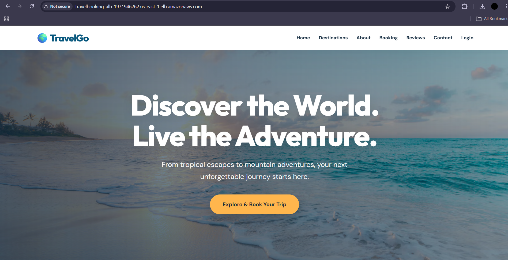
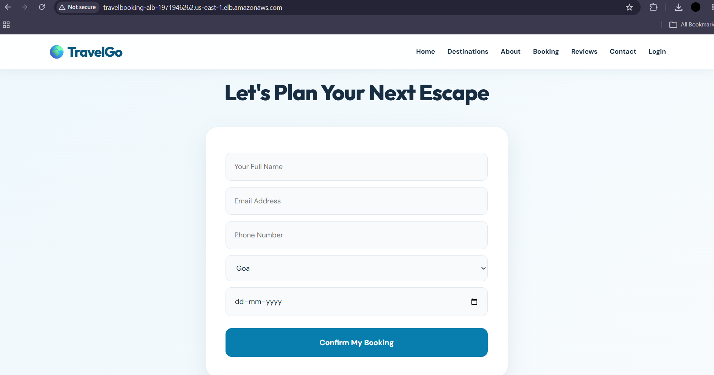
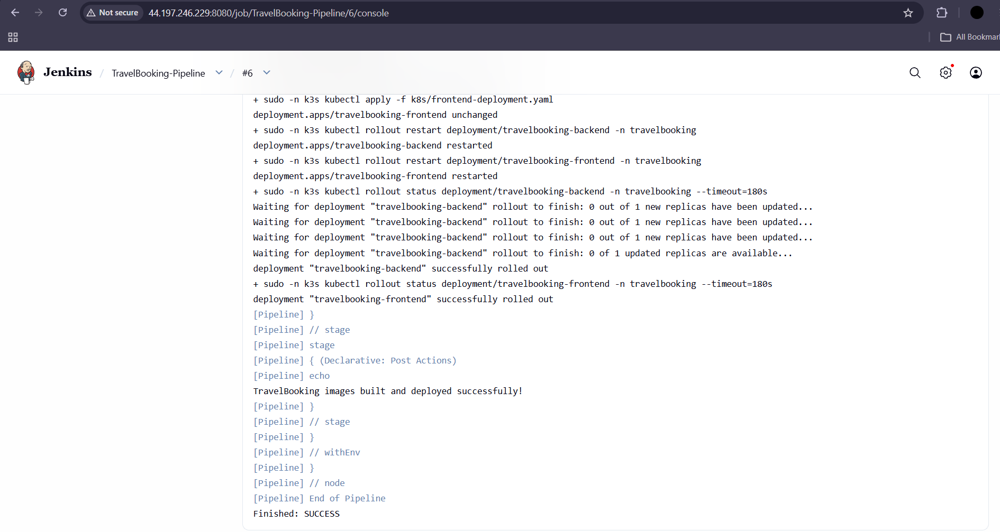
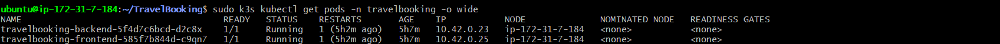
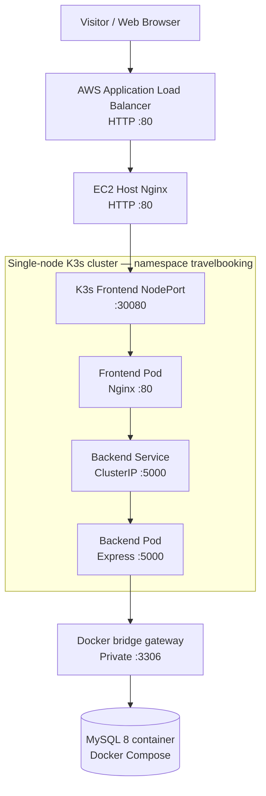
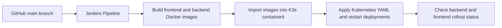

# 🌍 TravelGo — Full-Stack Travel Booking & DevOps Deployment

**TravelGo** is a travel booking application and a hands-on DevOps deployment project. Visitors can explore travel destinations and submit booking requests. An administrator can sign in to review bookings stored in MySQL.

The project demonstrates how source code moves from **GitHub → Jenkins → Docker images → Kubernetes (K3s)** and how visitors reach the application through an **AWS Application Load Balancer (ALB)**. The MySQL database runs separately using Docker Compose.

> **Project status:** A working deployment was demonstrated on one AWS EC2 Ubuntu 24.04 server. This is a learning/assignment deployment, **not a production-hardened reference architecture**. Follow the security notes before exposing your own copy publicly.

## Table of contents

1. [What the application does](#1-what-the-application-does)
2. [Screenshots](#2-screenshots)
3. [Technology stack](#3-technology-stack)
4. [Architecture and request flow](#4-architecture-and-request-flow)
5. [Repository layout](#5-repository-layout)
6. [Prerequisites](#6-prerequisites)
7. [Clone and configure](#7-clone-and-configure)
8. [Run with Docker Compose](#8-run-with-docker-compose)
9. [Deploy the two application Pods to K3s](#9-deploy-the-two-application-pods-to-k3s)
10. [Expose the app through Nginx and an AWS ALB](#10-expose-the-app-through-nginx-and-an-aws-alb)
11. [Automate deployments with Jenkins](#11-automate-deployments-with-jenkins)
12. [Test and verify](#12-test-and-verify)
13. [Troubleshooting](#13-troubleshooting)
14. [Security and limitations](#14-security-and-limitations)
15. [Glossary](#15-glossary)

## 1. What the application does

- Displays a modern travel website featuring **Maldives, Goa, and Manali**.
- Lets a visitor choose a destination and complete a booking form with name, email, phone number, and travel date.
- Sends booking form data from browser JavaScript to the Express API using `POST /api/booking`.
- Stores booking information in a MySQL database.
- Provides a separate login/admin interface to access booking information.
- Deploys the frontend and backend as **one Kubernetes Pod each** while keeping the database outside Kubernetes.

**Important:** Booking submission must be tested end-to-end in your own environment; an HTTP 200 response from the API health endpoint alone does not verify that a new booking was stored.

## 2. Screenshots

Screenshots are intentionally kept in `docs/screenshots/`. Add your captured images using the filenames below. Missing images will display as broken links until the files have been added.

### Live application



*Figure 1. TravelGo homepage, premium beach hero and navigation.*



*Figure 2. Customer booking form.*

### Deployment evidence

| Evidence | Screenshot |
|---|---|
| GitHub repository | [Repository view](docs/screenshots/04-github-repository.png) |
| Jenkins successful deployment |  |
| Docker images | [Images built](docs/screenshots/06-docker-images.png) |
| Docker Compose | [Three containers](docs/screenshots/07-docker-compose.png) |
| Docker custom network | [Custom bridge network](docs/screenshots/08-docker-network.png) |
| Kubernetes Pods |  |
| Kubernetes Services | [ClusterIP and NodePort](docs/screenshots/10-kubernetes-services.png) |
| AWS Application Load Balancer | [ALB details](docs/screenshots/11-aws-alb.png) |
| Healthy target group | [Target group health](docs/screenshots/12-target-group-healthy.png) |
| API verification | [HTTP 200 API test](docs/screenshots/13-api-test.png) |

The detailed project report can reuse all of these images. The architecture diagram below is also a report figure.

## 3. Technology stack

| Layer | Technology | What it is used for |
|---|---|---|
| Frontend | HTML5, CSS3, JavaScript | Website, destination cards, and booking form |
| Backend | Node.js, Express.js | HTTP API, booking logic, and admin endpoints |
| Database | MySQL 8, `mysql2` | Persistent booking data |
| Configuration/authentication | `dotenv`, `express-session` | Environment variables and sessions |
| Web servers | Nginx | Frontend static files and HTTP reverse proxy |
| Containers | Docker, Docker Compose | Package and run connected services |
| Container orchestration | K3s (lightweight Kubernetes) | Run frontend and backend Pods and Services |
| CI/CD | Jenkins | Checkout, build, import images, and deploy |
| Cloud | AWS EC2, AWS ALB, VPC, security groups | Hosting and incoming traffic |
| Source control | Git, GitHub | Version history and pipeline source |
| Earlier/manual process option | PM2 | A standalone Node.js process manager; **not used for the final Kubernetes backend** |

## 4. Architecture and request flow

### 4.1 Public request flow



### 4.2 Continuous deployment flow



### 4.3 Why Docker Compose *and* Kubernetes?

The assignment demonstrates both approaches on the **same EC2 machine**:

- **Docker Compose** runs three connected containers: `frontend`, `backend`, and `database`, all attached to the custom bridge network `travelbooking-network`.
- **K3s** independently runs exactly **two application Pods**: `travelbooking-frontend` and `travelbooking-backend`.
- The **K3s backend** connects to the **Compose-managed MySQL database**, not to a database Pod.
- **AWS ALB** forwards public traffic to the **EC2 host's Nginx**, which proxies requests to the **K3s frontend**.

These are two running application environments sharing the Docker-managed database. The public ALB path uses the **Kubernetes application**, not the Compose frontend. System Pods in the `kube-system` namespace do not count toward the assignment's two *application* Pods.

## 5. Repository layout

```text
TravelBooking/
├── client/
│   ├── index.html              # TravelGo home page
│   ├── login.html              # Login interface
│   ├── admin.html              # Administration interface
│   ├── style.css               # Visual design
│   ├── script.js               # Destination selection and booking API call
│   ├── images/                 # Destination photos
│   ├── nginx.conf              # Frontend container /api reverse proxy
│   └── Dockerfile              # Frontend container image
├── server/
│   ├── app.js                  # Express API
│   ├── config/db.js            # MySQL connection configuration
│   ├── package.json
│   ├── package-lock.json
│   └── Dockerfile              # Backend container image
├── db/
│   └── init.sql                # Initial database schema
├── k8s/
│   ├── backend-service.yaml
│   ├── backend-deployment.yaml
│   ├── frontend-service.yaml
│   └── frontend-deployment.yaml
├── compose.yaml                # Three Compose services
├── Jenkinsfile                 # CI/CD pipeline
├── docs/
│   └── screenshots/            # Documentation evidence
├── .gitignore
└── README.md
```

Some folders such as `docs/screenshots/` must be created when you add documentation; a checkout may not include local-only backups. Never commit `.env` or any real passwords.

## 6. Prerequisites

For a complete AWS deployment, you will need:

- An AWS account and an **Ubuntu 24.04 EC2 instance** with enough memory and disk for Docker, Jenkins, MySQL and K3s; the demonstrated deployment expanded the root disk to **20 GiB**.
- An EC2 SSH key pair (`.pem`) and SSH access from your computer.
- Git, Docker Engine, Docker Compose plugin, K3s, Nginx and Jenkins on the EC2 host.
- GitHub access to [this repository](https://github.com/Saf1111/TravelBooking).
- A VPC with **at least two public subnets in different Availability Zones** for an internet-facing ALB.
- A basic understanding of the Linux command line. All server commands below run on EC2 unless specified otherwise.

**Cost warning:** EC2, EBS and AWS ALB can incur charges, even for a demonstration. Stop or delete unused resources when the assignment is finished.

### 6.1 AWS network permissions

Use **separate security groups** for the ALB, EC2 app server and administration access. A reasonable starting policy is:

| Resource | Inbound access |
|---|---|
| ALB | TCP 80 from the internet for a demonstration; preferably HTTPS 443 with a certificate |
| EC2 Nginx | TCP 80 **only from the ALB security group** |
| EC2 SSH | TCP 22 only from your trusted IP |
| Jenkins | TCP 8080 only via a trusted source or SSH tunnel, **not open to everyone** |
| MySQL | No public inbound rule |

The final application uses local Nginx to forward to K3s NodePort `30080`; you normally do **not** need to expose that NodePort publicly through the EC2 security group.

## 7. Clone and configure

### 7.1 Connect to EC2

In Git Bash or your local terminal, replace the key path and public IP:

```bash
ssh -i /path/to/your-key.pem ubuntu@YOUR_EC2_PUBLIC_IP
```

An EC2 instance's auto-assigned public IPv4 address may change after a stop/start. An ALB DNS name normally remains stable while the load balancer exists.

### 7.2 Install core tools

```bash
sudo apt update
sudo apt install -y git curl nginx
```

Install supported Docker Engine/Compose, Jenkins and K3s following their respective official Ubuntu instructions. **Verify versions** rather than assuming the applications are already present:

```bash
git --version
docker --version
docker compose version
sudo systemctl is-active docker nginx jenkins k3s
sudo k3s kubectl get nodes
```

In the demonstrated setup, the K3s built-in **Traefik ingress was disabled** to avoid a port-80 conflict with host Nginx. For a new setup, choose the ingress architecture before exposing ports; do not run competing services on host port 80.

### 7.3 Clone the repository

```bash
git clone https://github.com/Saf1111/TravelBooking.git
cd TravelBooking
```

### 7.4 Configure secrets safely

The Compose file needs environment variables. Create a **local, untracked** `.env` file containing your own newly generated values:

```dotenv
DB_PASSWORD=REPLACE_WITH_STRONG_RANDOM_PASSWORD
MYSQL_ROOT_PASSWORD=REPLACE_WITH_DIFFERENT_STRONG_RANDOM_PASSWORD
SESSION_SECRET=REPLACE_WITH_LONG_RANDOM_SESSION_SECRET
ADMIN_USERNAME=REPLACE_WITH_ADMIN_USERNAME
ADMIN_PASSWORD=REPLACE_WITH_STRONG_RANDOM_ADMIN_PASSWORD
```

You can edit it using `vim .env`. The application also uses `PORT`, `DB_HOST`, `DB_USER` and `DB_NAME`, supplied in the Compose or Kubernetes manifests. **Never commit `.env`**; ensure `.gitignore` excludes it and confirm with `git status`.

> The README does not publish live credentials. If credentials have ever appeared in chat logs, screenshots or source control, rotate them before any public use.

## 8. Run with Docker Compose

### 8.1 Create the custom Docker network

```bash
sudo docker network create travelbooking-network
```

If Docker reports that the network already exists, inspect it rather than recreating it.

### 8.2 Verify Compose configuration and start services

```bash
sudo docker compose config --quiet
sudo docker compose up -d --build
sudo docker compose ps
```

Expected services:

| Service | Purpose | Expected result |
|---|---|---|
| `frontend` | Static site via Nginx | Running; demonstration uses `127.0.0.1:8082` |
| `backend` | Express API | Running; internal port 5000 |
| `database` | MySQL 8 | Running, **healthy** |

The demonstrated setup attached all three Compose containers to `travelbooking-network`, and stored MySQL data in a named Docker volume. Database initialization comes from `db/init.sql` on the first initialization of an empty data volume.

### 8.3 Test and inspect

```bash
curl -I http://127.0.0.1:8082/
sudo docker compose logs --tail=30 backend
sudo docker network inspect travelbooking-network \
  --format 'Network: {{.Name}} | Driver: {{.Driver}} | Containers: {{len .Containers}}'
```

**Do not run `docker compose down -v`** unless you intentionally want to remove persisted database data. To stop without deleting volumes, use `sudo docker compose down`.

## 9. Deploy the two application Pods to K3s

### 9.1 Why a special MySQL address is needed

Kubernetes Pods do not automatically resolve the Compose-only hostname `database`. In this **single-host demonstration**, the database published MySQL on the Docker bridge gateway (`172.18.0.1:3306`) rather than a public interface, and the Kubernetes backend used `DB_HOST=172.18.0.1`.

**This gateway is environment-specific, not portable:** verify yours with `sudo docker network inspect travelbooking-network`; recreate or readdress the network only with care. Cross-network traffic may require additional firewall rules. A production deployment should use a stable, secured database endpoint instead of hardcoding a Docker bridge address.

### 9.2 Create namespace and Kubernetes Secret

```bash
sudo k3s kubectl create namespace travelbooking
```

If the namespace already exists, continue. Load your local `.env` **without printing its values**:

```bash
set -a
source .env
set +a
sudo k3s kubectl -n travelbooking create secret generic backend-secret \
  --from-literal=DB_PASSWORD="$DB_PASSWORD" \
  --from-literal=SESSION_SECRET="$SESSION_SECRET" \
  --from-literal=ADMIN_USERNAME="$ADMIN_USERNAME" \
  --from-literal=ADMIN_PASSWORD="$ADMIN_PASSWORD"
unset DB_PASSWORD MYSQL_ROOT_PASSWORD SESSION_SECRET ADMIN_PASSWORD
```

The Secret must be created **before** the backend Pod starts. If the Secret already exists, update it using a secure, reviewed process rather than pasting its contents into logs. Kubernetes Secrets are not automatically encrypted at rest unless the cluster is configured accordingly.

### 9.3 Build and import container images

K3s uses a container runtime that is separate from the host's Docker image store. Building an image with `docker build` does **not** make it automatically available to K3s.

```bash
sudo docker build -t travelbooking-frontend:latest ./client
sudo docker build -t travelbooking-backend:latest ./server
sudo docker save travelbooking-frontend:latest travelbooking-backend:latest | \
  sudo k3s ctr images import -
```

The existing Kubernetes manifests use `imagePullPolicy: Never` with these locally imported images. Therefore the import step is necessary on this node.

### 9.4 Apply Services and Deployments

```bash
sudo k3s kubectl apply -f k8s/backend-service.yaml
sudo k3s kubectl apply -f k8s/frontend-service.yaml
sudo k3s kubectl apply -f k8s/backend-deployment.yaml
sudo k3s kubectl apply -f k8s/frontend-deployment.yaml
sudo k3s kubectl get pods,svc -n travelbooking
```

Expected **application** components:

| Resource | Name | Role |
|---|---|---|
| Pod | `travelbooking-frontend-…` | Nginx frontend, one replica |
| Pod | `travelbooking-backend-…` | Express backend, one replica |
| Service | `frontend` | NodePort `30080` → container port 80 |
| Service | `backend` | ClusterIP port `5000` |

There is **no MySQL Pod**. The database remains in Compose. K3s itself has additional system Pods; the **two-Pod requirement concerns application Pods in `travelbooking`**.

### 9.5 Verify frontend-to-backend-to-database connectivity

```bash
sudo k3s kubectl logs -n travelbooking deployment/travelbooking-backend --tail=20
curl -I http://127.0.0.1:30080/
curl -i http://127.0.0.1:30080/api
```

The backend should report that it is listening on port 5000 and connected to MySQL, and the API endpoint should return JSON such as:

```json
{"status":"TravelGo Backend Running"}
```

## 10. Expose the app through Nginx and an AWS ALB

### 10.1 Configure host Nginx as a reverse proxy

The EC2 host's Nginx listens on port `80` and forwards requests to the frontend NodePort on the **same machine**. A minimal example server block is:

```nginx
server {
    listen 80;
    server_name _;

    location / {
        proxy_pass http://127.0.0.1:30080;
        proxy_set_header Host $host;
        proxy_set_header X-Real-IP $remote_addr;
        proxy_set_header X-Forwarded-For $proxy_add_x_forwarded_for;
        proxy_set_header X-Forwarded-Proto $scheme;
    }
}
```

On the demonstrated server, the site file was `/etc/nginx/sites-enabled/travelbooking`. Back up existing configuration **outside** the `sites-enabled` directory before editing. Validate and reload:

```bash
sudo nginx -t
sudo systemctl reload nginx
curl -i http://127.0.0.1/api
```

### 10.2 Create AWS target group

In AWS Console, navigate to **EC2 → Target Groups**:

1. Create target group `travelbooking-tg` with **Instances** as target type, **HTTP:80**, and the EC2 instance's VPC.
2. Set the health-check path to `/api` (returns HTTP 200 in the demonstrated app).
3. Register the EC2 instance on port 80.
4. Confirm the registered target becomes **Healthy**.

### 10.3 Create AWS Application Load Balancer

In **EC2 → Load Balancers**, create `travelbooking-alb`:

1. Select **Application Load Balancer**, **Internet-facing**, **IPv4**.
2. Select the same VPC and **two public subnets in different Availability Zones**; their route tables require `0.0.0.0/0 → Internet Gateway`.
3. Attach a **dedicated ALB security group** permitting public HTTP 80 for the demo.
4. Add a listener **HTTP:80**, forwarding to `travelbooking-tg`.
5. Permit traffic from the ALB security group to the EC2 instance on port 80.
6. Wait for ALB status **Active** and target status **Healthy**.

For real-world use, add a domain, ACM TLS certificate, HTTPS:443 listener and HTTP-to-HTTPS redirect. Do not treat an HTTP-only demo as production-ready.

### 10.4 Verify ALB

Get the **DNS name** from AWS Console. Do not use the words `YOUR-ALB-DNS-NAME` literally:

```bash
curl -I --max-time 15 http://YOUR_ACTUAL_ALB_DNS_NAME/
curl -i --max-time 15 http://YOUR_ACTUAL_ALB_DNS_NAME/api
```

A successful request returns HTTP 200. The ALB routes through EC2 host Nginx to the Kubernetes frontend; the frontend's `/api` proxy forwards to the Kubernetes backend.

## 11. Automate deployments with Jenkins

### 11.1 Jenkins setup

Install Jenkins on the EC2 host, complete first-time setup, and create a Pipeline job named **`TravelBooking-Pipeline`**. Configure:

| Jenkins field | Value |
|---|---|
| Pipeline definition | Pipeline script from SCM |
| SCM | Git |
| Repository URL | `https://github.com/Saf1111/TravelBooking.git` |
| Branch | `*/main` |
| Script Path | `Jenkinsfile` |

Jenkins must be able to use Docker and have permission to perform the specific K3s deployment operations. **Do not expose Docker control or unrestricted passwordless `sudo k3s` to untrusted Jenkins jobs**; these are powerful, effectively host-level permissions. Use a trusted agent, appropriate role separation and narrowly scoped access.

### 11.2 Pipeline stages

The provided `Jenkinsfile` performs the following:

1. **Checkout** — Download the latest source code from the `main` branch.
2. **Verify Docker** — Check the Docker and Compose commands are available.
3. **Build Docker Images** — Build `travelbooking-frontend:latest` and `travelbooking-backend:latest`.
4. **Import Images to K3s** — Transfer the Docker images into K3s's containerd image store.
5. **Deploy to Kubernetes** — Apply four K8s YAML files; restart both Deployments; wait for successful rollouts.

A run was confirmed with `Finished: SUCCESS` and successful frontend and backend rollouts.

### 11.3 Trigger a deployment

```bash
# On your development machine or server, after editing application files:
git add client/ server/ k8s/ Jenkinsfile
git commit -m "Update TravelGo application"
git push origin main
```

Only stage reviewed files. If you change just the frontend, `git add client/index.html client/style.css` is more precise. Then in Jenkins open **TravelBooking-Pipeline → Build Now** and inspect **Console Output**.

**Important:** The demonstrated pipeline runs when you manually select **Build Now**; a GitHub webhook or polling trigger must be configured separately if you want every Git push to trigger a build without manual action.

**Image-tag limitation:** This demo reuses `:latest` and restarts Deployments after import. For production, use immutable tags (such as Git commit hashes), a proper image registry, controlled rollout and rollback policies.

## 12. Test and verify

| Test | Command or action | Expected |
|---|---|---|
| Compose containers | `sudo docker compose ps` | Frontend/backend Up, MySQL healthy |
| Custom bridge | `sudo docker network inspect travelbooking-network --format '{{.Name}}: {{len .Containers}} containers'` | Three attached containers |
| K3s namespace | `sudo k3s kubectl get pods -n travelbooking` | Two app Pods, both `1/1 Running` |
| K3s services | `sudo k3s kubectl get svc -n travelbooking` | `backend` ClusterIP and `frontend` NodePort |
| Database connection | `sudo k3s kubectl logs -n travelbooking deployment/travelbooking-backend --tail=20` | MySQL connection message |
| Frontend | `curl -I http://127.0.0.1:30080/` | HTTP 200 |
| API via cluster frontend | `curl -i http://127.0.0.1:30080/api` | HTTP 200 and JSON |
| API via ALB | `curl -i http://ACTUAL_ALB_DNS/api` | HTTP 200 and JSON |
| Jenkins pipeline | Jenkins Console Output | `Finished: SUCCESS` |
| Customer workflow | Use the booking form with safe test data | Confirm response and verify booking record through authorized admin/database inspection |

## 13. Troubleshooting

**ALB DNS times out:** Confirm the ALB is *Internet-facing*, its HTTP:80 listener is forwarding to the correct target group, the ALB security group's **inbound** TCP 80 rule allows the intended source, both subnets are public, and the EC2 security group allows TCP 80 from the ALB SG. A **Healthy** target alone does not prove internet-facing ALB access.

**`Could not resolve host: YOUR-ALB-DNS-NAME`:** That is placeholder text; copy the real DNS hostname from the AWS ALB details page.

**Kubernetes Pods show `ImagePullBackOff` or image missing:** Ensure image names match the manifests and import them into K3s containerd. The demo uses `imagePullPolicy: Never`.

**Backend cannot reach MySQL:** Check `sudo docker compose ps`, MySQL health, the DB connection environment, the actual Docker bridge gateway, MySQL's private port binding, and any cross-network firewall restrictions. Never expose port 3306 to the public internet to fix this.

**Jenkins cannot find `k8s/backend-service.yaml`:** Commit and push the `k8s/` manifests. Jenkins checks out the repository; it cannot use local files that were never committed.

**Jenkins `sudo: a password is required`:** Jenkins has not been granted deployment access. Configure least-privilege deployment credentials/permissions, not unrestricted general-purpose sudo.

**After EC2 stop/start, website stops working:** Check `sudo systemctl is-active k3s nginx docker jenkins`, then `sudo k3s kubectl get pods -n travelbooking`, `sudo docker compose ps`, and host/ALB API tests. If K3s was disabled, start it with `sudo systemctl start k3s` and review its boot configuration.

**New UI is not visible:** Confirm changes were committed, pushed and built by Jenkins, that both Pod rollouts succeeded, and hard-refresh the browser. Reusing `latest` tags can make troubleshooting more difficult.

## 14. Security and limitations

This deployment demonstrates a working DevOps workflow, but it has several important constraints:

- **Rotate all exposed database, admin and session credentials** before public use; use strong unique values and secure secret storage.
- **Enable HTTPS** on the ALB with AWS Certificate Manager; HTTP displays a “Not secure” browser warning.
- **Do not expose Jenkins to the public internet.** Prefer private access or an SSH tunnel; use strong authentication and regular updates.
- **Do not use the AWS default security group as a broad public entry point** if other resources share it. Use separate least-privilege security groups.
- **Restrict Jenkins deployment privileges.** Docker access and `sudo k3s` can provide powerful host access.
- **MySQL should remain private**, with backups and explicit recovery procedures.
- **Single node means no high availability.** There is only one EC2 worker; the ALB does not make the app highly available if the instance fails.
- **Two replicas are not running.** The Kubernetes requirement is exactly two *application Pods total*, one per application component.
- **No automatic GitHub-to-Jenkins trigger is assumed.** The pipeline was verified via a manual build.
- Use **immutable image tags, monitoring, resource limits, health probes and secure sessions** before extending this to production.
- Public screenshots and logs must not include passwords, private keys, session secrets, or unredacted customer booking data.

## 15. Glossary

| Term | Meaning |
|---|---|
| **EC2** | AWS virtual server hosting this demonstration |
| **GitHub** | Stores project code and version history |
| **Jenkins** | Automates build and deployment tasks |
| **Docker image** | Packaged filesystem and instructions for an application container |
| **Docker Compose** | Defines and starts multiple connected Docker services |
| **Docker bridge network** | Private virtual network for Docker containers |
| **Kubernetes / K3s** | Runs and manages application Pods and Services |
| **Pod** | Smallest Kubernetes unit that runs one or more containers |
| **Deployment** | Declares desired app replicas and manages Pod replacement |
| **ClusterIP** | Internal Kubernetes Service address |
| **NodePort** | Exposes a Kubernetes Service on a node port |
| **Reverse proxy** | Receives requests and forwards them to another server |
| **ALB** | AWS HTTP/HTTPS load balancer that routes requests to registered targets |
| **Target group** | Collection of destinations monitored and used by the ALB |
| **CI/CD** | Continuous integration and delivery/deployment workflow |

---

### Project links

- **Source code:** https://github.com/Saf1111/TravelBooking
- **Deployment:** AWS EC2 / K3s / Docker Compose / Jenkins / AWS ALB

*TravelGo — Explore More. Experience More.*
